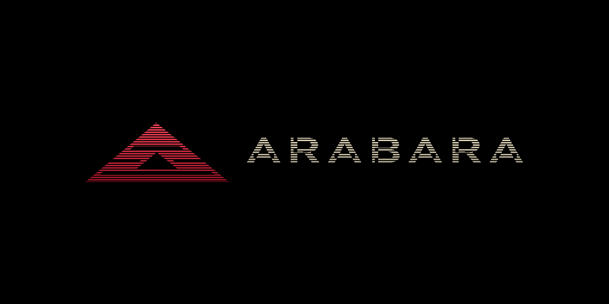

# Arabara

So uhh I made a web browser with extreme optimizing ram, specially when running background applications.

My original purpose when creating it was... to be able to play Valorant and Call Discord at the same time without overflowing RAM.

I dont really recommend you to use this as a main browser because the features are very limited, for optimizing ram.

So yes, you can download it here ---> **[[ DOWNLOAD ]](https://github.com/ruptav1/ArabaraWebBrowser/releases/latest)**
